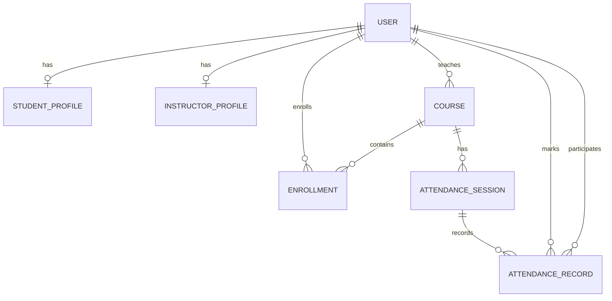

# Academy Management System Database and Schema

## 1. Database overview

This project is built with Django and uses the Django ORM to manage the database. By default, the app runs against SQLite for local development, which keeps the database in the file `backend/db.postgres`.

The backend configuration in `backend/config/settings.py` supports both:

- SQLite (default): used for local development
- PostgreSQL (optional): enabled when environment variables such as `DB_NAME`, `DB_USER`, `DB_PASSWORD`, `DB_HOST`, and `DB_PORT` are provided

This means the application can be developed locally without needing a separate database server while still supporting production-ready PostgreSQL deployment.

## 2. Database engine configuration

The database is configured in `backend/config/settings.py`.

Default local configuration:

```python
DATABASES = {
    "default": {
        "ENGINE": "django.db.backends.sqlite3",
        "NAME": BASE_DIR / "db.sqlite3",
    }
}
```

Optional PostgreSQL configuration:

```python
DATABASES = {"default": {
    "ENGINE": "django.db.backends.postgresql",
    "NAME": os.environ["DB_NAME"],
    "USER": os.environ.get("DB_USER", "postgres"),
    "PASSWORD": os.environ.get("DB_PASSWORD", ""),
    "HOST": os.environ.get("DB_HOST", "localhost"),
    "PORT": os.environ.get("DB_PORT", "5432"),
}}
```

The app also sets `AUTH_USER_MODEL = "academy.User"`, meaning the project uses a custom User model instead of Django's default auth user table.

## 3. Core data model

The application models are defined in `backend/academy/models.py` and represent the academy domain:

- users and roles
- student and instructor profiles
- courses
- enrollments
- attendance sessions
- attendance records

## 4. Primary tables and schema

### 4.1 User

The custom user model is the central identity for the system.

```python
class User(AbstractUser):
    ADMIN, INSTRUCTOR, STUDENT = "admin", "instructor", "student"
    ROLES = [(ADMIN, "Admin"), (INSTRUCTOR, "Instructor"), (STUDENT, "Student")]
    role = models.CharField(max_length=12, choices=ROLES, default=STUDENT)
```

Fields inherited from Django's `AbstractUser` include:

- `id`
- `username`
- `first_name`
- `last_name`
- `email`
- `password`
- `is_staff`
- `is_active`
- `is_superuser`
- `date_joined`
- `last_login`

Key behavior:

- users have a `role` of `admin`, `instructor`, or `student`
- if a user is marked as a superuser, the system automatically sets their role to `admin`
- this allows standard Django admin access while still keeping a domain-specific role model

This is the main user table for the system and is used across all other entities.

### 4.2 StudentProfile

```python
class StudentProfile(models.Model):
    user = models.OneToOneField(User, on_delete=models.CASCADE, related_name="student_profile")
    student_number = models.CharField(max_length=32, unique=True, null=True, blank=True)
    phone = models.CharField(max_length=30, blank=True)
```

Purpose:

- stores extra information for a student
- each user can have at most one student profile
- `student_number` is unique if present
- `phone` stores a contact phone number

Relationship:

- one-to-one with `User`
- each user can have at most one profile record; profiles are optional at the schema level

### 4.3 InstructorProfile

```python
class InstructorProfile(models.Model):
    user = models.OneToOneField(User, on_delete=models.CASCADE, related_name="instructor_profile")
    staff_number = models.CharField(max_length=32, unique=True, null=True, blank=True)
    phone = models.CharField(max_length=30, blank=True)
```

Purpose:

- stores extra information for an instructor
- one-to-one relationship with `User`
- optional `staff_number` and phone number

### 4.4 Course

```python
class Course(models.Model):
    code = models.CharField(max_length=20, unique=True)
    title = models.CharField(max_length=200)
    instructor = models.ForeignKey(User, null=True, blank=True, on_delete=models.SET_NULL,
                                   related_name="courses_taught", limit_choices_to={"role": "instructor"})
    capacity = models.PositiveIntegerField(default=30)
```

Fields:

- `code`: unique course code such as `CS101`
- `title`: course title
- `instructor`: the assigned instructor for the course
- `capacity`: maximum number of students allowed in the course

Business rules:

- `limit_choices_to` filters the choices offered by Django forms and the admin; it does not create a database constraint on the user's role
- if the instructor is deleted, the course remains but the `instructor` field becomes `NULL`

### 4.5 Enrollment

```python
class Enrollment(models.Model):
    student = models.ForeignKey(User, on_delete=models.CASCADE, related_name="enrollments",
                                limit_choices_to={"role": "student"})
    course = models.ForeignKey(Course, on_delete=models.CASCADE, related_name="enrollments")
    created = models.DateTimeField(auto_now_add=True)

    class Meta:
        unique_together = ("student", "course")
```

Purpose:

- records a student enrolling in a course
- prevents a student from enrolling in the same course twice

Relationships:

- many students can be enrolled in one course
- one student can enroll in many courses

This is the join table between `User` (students) and `Course`.
The unique student/course constraint prevents duplicate enrollments. The `limit_choices_to` setting is not a database-level constraint, so role validation must also be handled by the application.

### 4.6 AttendanceSession

```python
class AttendanceSession(models.Model):
    course = models.ForeignKey(Course, on_delete=models.CASCADE, related_name="attendance_sessions")
    date = models.DateField()
    created_by = models.ForeignKey(User, on_delete=models.PROTECT, related_name="attendance_sessions_created")
    created_at = models.DateTimeField(auto_now_add=True)
    updated_at = models.DateTimeField(auto_now=True)

    class Meta:
        constraints = [
            models.UniqueConstraint(fields=["course", "date"], name="unique_course_attendance_date"),
        ]
        ordering = ["-date", "course__code"]
```

Purpose:

- represents a single attendance-taking session for a course on a specific date
- there is one attendance session per course per day

Business rules:

- a course cannot have two attendance sessions for the same date
- `created_by` is protected from deletion to prevent breaking audit history

### 4.7 AttendanceRecord

```python
class AttendanceRecord(models.Model):
    PRESENT, ABSENT = "present", "absent"
    STATUS_CHOICES = [(PRESENT, "Present"), (ABSENT, "Absent")]

    session = models.ForeignKey(AttendanceSession, on_delete=models.CASCADE, related_name="records")
    student = models.ForeignKey(User, on_delete=models.CASCADE, related_name="attendance_records",
                                limit_choices_to={"role": User.STUDENT})
    status = models.CharField(max_length=8, choices=STATUS_CHOICES)
    marked_by = models.ForeignKey(User, on_delete=models.PROTECT, related_name="attendance_records_marked")
    marked_at = models.DateTimeField(auto_now=True)

    class Meta:
        constraints = [
            models.UniqueConstraint(fields=["session", "student"], name="unique_student_attendance_session"),
            models.CheckConstraint(
                condition=models.Q(status__in=["present", "absent"]),
                name="attendance_status_present_or_absent",
            ),
        ]
        ordering = ["student__first_name", "student__username"]
```

Purpose:

- stores the attendance status of a specific student in a specific attendance session
- each student can only have one attendance entry per session
- only `present` or `absent` values are allowed
- the schema does not require every enrolled student to have a record in every session; it only constrains records that exist

Relationships:

- many attendance records belong to one attendance session
- each student may have many attendance records over time
- `marked_by` indicates which user recorded or corrected the attendance

## 5. Relationships and schema summary

The following relationship structure exists:

- `User` -> one-to-one -> `StudentProfile`
- `User` -> one-to-one -> `InstructorProfile`
- `User` -> many -> `Course` (as instructor)
- `User` -> many -> `Enrollment` (as student)
- `Course` -> many -> `Enrollment`
- `Course` -> many -> `AttendanceSession`
- `AttendanceSession` -> many -> `AttendanceRecord`
- `User` -> many -> `AttendanceRecord` (as student and marker)

## 6. Entity relationship diagram



## 7. Key constraints and data integrity rules

The schema enforces several important rules:

- a course code must be unique
- a student number and staff number are unique when present
- a student cannot enroll in the same course twice
- a course cannot have two attendance sessions on the same date
- a student cannot have more than one attendance record for the same session
- attendance status must be only `present` or `absent`
- role choices and `limit_choices_to` guide Django forms/admin but do not by themselves enforce valid roles or role-specific foreign keys at the database level
- profile, enrollment, and student attendance rows are configured to cascade when their referenced user is deleted; users referenced as attendance creators/markers are protected from deletion
- deleting an assigned instructor leaves the course and clears its instructor reference

## 8. Practical interpretation

In normal business terms, the database models the following workflow:

1. A user is created with a role: admin, instructor, or student.
2. Students and instructors may have profile records with extra personal data.
3. An admin creates courses and assigns an instructor.
4. Students enroll in courses.
5. An instructor or admin creates an attendance session for a course on a specific date.
6. The application records each student's attendance as `present` or `absent`; the schema validates each record but does not guarantee that all enrolled students have a record.
7. Each record tracks who marked it and when it was marked.

## 9. Database files and migration notes

The project includes Django migrations in `backend/academy/migrations/` and uses Django's migration system to evolve the schema over time.

The main migration sequence includes:

- initial app schema
- student and instructor profile additions
- attendance session and attendance record model creation
- attendance status validation constraint

This indicates the schema was designed in phases and later extended to support the attendance tracking features.

## 10. Current SQLite database check

The local `backend/db.sqlite3` file was inspected against the models and migrations. It contains the academy tables for users, profiles, courses, enrollments, attendance sessions, and attendance records, along with Django's user-group and permission join tables.

The database records all four academy migrations as applied (`0001` through `0004`). SQLite's `PRAGMA integrity_check` returned `ok`, and `PRAGMA foreign_key_check` reported no violations. The expected unique indexes for course codes, profile identifiers, student/course enrollments, course/date sessions, and session/student attendance records are present.

The Django management commands could not be run in the current system Python because the `django-cors-headers` dependency is not installed there. The database-level checks above were performed read-only and did not modify the database.

## 11. Summary

The system database is a classic Django relational schema centered around a custom `User` model and a set of academic entities:

- `User` handles authentication and role assignment
- `Course` represents class offerings
- `Enrollment` links students to courses
- `AttendanceSession` captures a daily course attendance event
- `AttendanceRecord` stores the attendance state for each enrolled student

Because the app uses Django's ORM, the database schema is easy to manage, extend, and migrate as the system grows.
